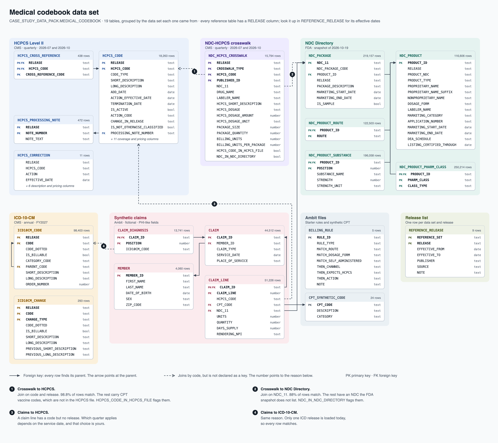

# Ambit implementation case study

Take-home exercise for the **Applied AI and Software Engineer** role at Ambit (Digital Transformation).

You build a working slice of an AI-assisted medical codebook generator in a Snowflake sandbox that we provide. The data is already loaded there as clean tables, so you can start on the problem straight away.

## Start here

| File | What it is |
|---|---|
| [`Ambit_Implementation_Case_Study_Candidate_Brief.docx`](Ambit_Implementation_Case_Study_Candidate_Brief.docx) | The brief. Read this first. |
| [`medical_codebook_erd.png`](medical_codebook_erd.png) | Diagram of the tables in your sandbox: what each one is, the columns you will use most, and how they join. |
| [`example_joins.sql`](example_joins.sql) | Short queries that show how to join the tables. Starting points, not answers. |
| [`data-pack/`](data-pack/) | The published source files, for reference only. You do not need to load them. |

## Timing

- You receive the exercise on a Friday and present your work the following Friday.
- Please spend about 8 hours in total. Choose the 8 hours that suit you, but please stop at 8.
- Send your deliverables by the end of the day on Thursday, the day before your session.

## Your sandbox

- The data is in the `MEDICAL_CODEBOOK` schema of a read-only database called `CASE_STUDY_DATA_PACK`.
- Do all of your work in the sandbox, in the database we give you to work in. Please do not build in a personal or trial account.
- Start with the `REFERENCE_RELEASE` table. It lists every data set and release, with the dates each release is in effect.
- Each table has a comment that says what a row is and what to watch for. `CLEANING_LOG` lists every change we made to the published files.

## Things to know about the data

- **The claims are fictional, but treat them as if they were real.** They include PHI-like fields: names, dates of birth, member IDs, and ZIP codes.
- **CPT is licensed by the AMA**, so we use synthetic codes. Do not substitute real CPT content.
- **Clean does not mean complete.** The crosswalks cover Medicare Part B drugs only, and not every code in one table has a match in another. Finding and handling those gaps is part of the exercise.

Questions: innovation@ambitinc.com
